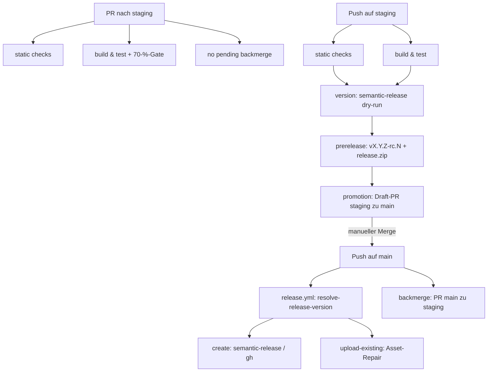

← [Zurück zur Übersicht](index.md)

# Projektinfrastruktur — Architektur

## Beteiligte Komponenten

| Komponente | Typ | Rolle |
|------------|-----|-------|
| `vite build` | Build | erzeugt den statischen Produktions-Build unter `dist/` |
| Vitest + `@vitest/coverage-v8` | Test | Testsuite; `thresholds.lines: 70` ist das Coverage-Gate |
| ESLint / Prettier / `tsc --noEmit` | Statische Prüfung | Lint, Format und Typprüfung in `static checks` |
| `.githooks/*` | Git-Hooks | lokale Gates vor Commit/Push |
| `scripts/resolve-release-version.mjs` | Skript | entscheidet in `release.yml` zwischen `create`, `upload-existing` (Repair) und `none`; enthält den Prerelease-Guard |
| `release.config.js` | Konfiguration | semantic-release mit conventionalcommits-Preset |
| `.github/actions/build-and-package` | Composite Action | `npm ci` + `npm run build` + ZIP `dist/` → `release.zip` |
| `.github/actions/security-scan` | Composite Action | `npm audit` (blockierend auf Produktions-Dependencies, Full-Report inkl. dev) |

## Abhängigkeiten

Alle sieben Workflows hängen von der Branch-Topologie `staging` → `main` ab.
Der `workflow_run`-Trigger von `staging-to-main-promotion.yml` referenziert
den Display-Namen `Pre-Release` aus `staging-ci.yml` — bei Umbenennung muss
die Referenz mitgeändert werden.

## Datenfluss / Ablauf

## Skalierung und Zuverlässigkeit

- **Asset-Repair:** `resolve-release-version.mjs` erkennt Releases mit
  fehlendem `release.zip` und lädt das Asset zum bestehenden Release nach
  (`upload-existing`), inklusive Fallback-Scan über alle Releases; der
  Prerelease-Guard verhindert die Reparatur alter RCs (Vorlage §11.1).
- **Cold-Start:** `workflow_run`- und `push: main`-Trigger greifen erst,
  sobald die Workflow-Dateien auf `main` liegen — der erste
  `staging`→`main`-Promotion-PR wird einmalig manuell angelegt.
- **Backmerge-Pflicht:** `no pending backmerge` verhindert, dass reguläre
  PRs gemergt werden, solange ein `main`→`staging`-Backmerge offen ist.
