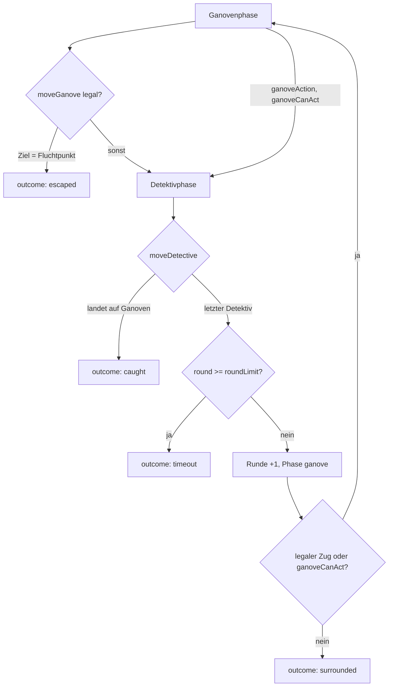

← [Zurück zur Übersicht](index.md)

# Spiel-Engine — Technischer Ablauf: Runde und Spielende

## Übersicht

Jede Runde hat zwei Phasen: zuerst `ganove` (ein Zug oder eine
Aktionsrunde), dann `detektive` (jeder Detektiv einzeln, feste
Reihenfolge `activeDetectiveIndex` 0→n-1). Die Regel-Actions
`moveGanove`/`moveDetective`/`ganoveAction` treiben die Phasenmaschine;
`Movement.ts` validiert jeden Zug; das Spiel endet über `outcome`
(`caught`/`surrounded`/`escaped`/`timeout`/`draw`).

## Ablauf

### 1. Ganovenphase

`moveGanove(target)`:

1. `requireRunningGame("ganove")` — `map` gesetzt, `outcome === null`,
   Phase `ganove`; sonst `MoveError` (`no_game`/`game_over`/`wrong_phase`).
2. `validateGanoveMove(moveContext, target)` — Zugzwang
   (`stay_forbidden`), Nachbarschaft (`not_adjacent`), gesperrte Kante
   (`blocked_edge`), Detektiv-besetztes Ziel (`occupied`).
3. `ganovePosition` setzen, `move`-Logeintrag (`actor`, `from`, `to`,
   `edgeType`).
4. Fluchtprüfung: `target ∈ escapeNodeIds` → `outcome "escaped"` +
   `result`-Log.
5. Sonst `phase = "detektive"`, `activeDetectiveIndex = 0`.

Alternative `ganoveAction()` (einzige Zugzwang-Ausnahme): nur bei
`ganoveCanAct === true` (Missionssystem-Hook); der Ganove bleibt stehen
und fangbar, `action`-Log, danach Detektivphase.

Beteiligte Komponenten:
- `useGameStore.moveGanove` / `useGameStore.ganoveAction`
- `Movement.validateGanoveMove` — Regelprüfung

### 2. Detektivphase

`moveDetective(target)` für den Detektiv an `activeDetectiveIndex`:

1. `requireRunningGame("detektive")` +
   `validateDetectiveMove(moveContext, index, target)` — gleiche
   Basisregeln, aber besetzte Knoten sind legal (Teilen erlaubt).
2. `detektivePositions[index]` setzen, `move`-Logeintrag mit
   `detectiveIndex`.
3. **Fangprüfung sofort nach diesem Einzelzug:**
   `target === ganovePosition` → `outcome "caught"` + `result`-Log;
   verbleibende Detektive ziehen nicht mehr.
4. Sonst: letzter Detektiv → Rundenende (Schritt 3); andernfalls
   `activeDetectiveIndex + 1`.

### 3. Rundenende (nach dem letzten Detektivzug oder `endDetectivePhase`)

1. Zeitlimit: `roundLimit !== null && round >= roundLimit` →
   `outcome "timeout"` + `result`-Log (Detektiv-Sieg).
2. Sonst `round + 1`, `phase = "ganove"`, `activeDetectiveIndex = 0`,
   `unblockExpiredEdges` (`untilRound < round` fällt weg).
3. Umzingelungsprüfung zu Beginn der Ganovenphase:
   `legalGanoveMoves` leer **und** `ganoveCanAct === false` →
   `outcome "surrounded"` + `result`-Log (Detektiv-Sieg).
   Dieselbe Prüfung läuft direkt nach `startGame` für Runde 1.

### 4. Remis

`abortAsDraw()` bei laufender Partie → `outcome "draw"` + `result`-Log.

## Fehlerbehandlung

| Fehler | `MoveError.reason` / Exception | Bedingung |
|--------|-------------------------------|-----------|
| Kein Spiel läuft | `no_game` | `map === null` |
| Partie beendet | `game_over` | `outcome !== null` |
| Falsche Phase | `wrong_phase` | Zug außerhalb der eigenen Phase |
| Kein Detektiv am Index | `not_active_detective` | `activeDetectiveIndex` ohne Position |
| Stehenbleiben | `stay_forbidden` | Ziel = aktueller Knoten (Zugzwang) |
| Kein Nachbarknoten | `not_adjacent` | keine Kante zum Ziel |
| Kante gesperrt | `blocked_edge` | `untilRound >= round` |
| Ziel besetzt (Ganove) | `occupied` | Detektiv steht auf dem Ziel |
| Keine Aktion | `no_action_available` | `ganoveAction` ohne `ganoveCanAct` |
| Ungültige Konfiguration | `GameConfigError` | `roundLimit` außerhalb `min`/`max`, `null` ohne `unlimited`, unbekannte `escapeNodeIds` |
