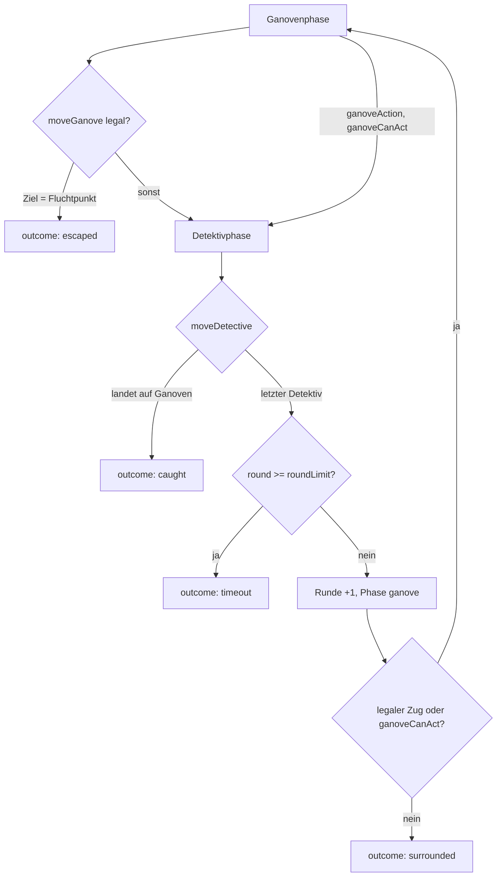

← [Zurück zur Übersicht](index.md)

# Spiel-Engine — Technischer Ablauf: Runde und Spielende

## Übersicht

Jede Runde hat zwei Phasen: zuerst `ganove` (ein Zug oder eine
Aktionsrunde), dann `detektive` (jeder Detektiv einzeln, feste
Reihenfolge `activeDetectiveIndex` 0→n-1). Die Regel-Actions
`moveGanove`/`moveDetective`/`ganoveAction` treiben die Phasenmaschine;
`Movement.ts` validiert jeden Zug; das Spiel endet über `outcome`
(`caught`/`surrounded`/`escaped`/`timeout`/`draw`).

## Ablauf

### 1. Ganovenphase

`moveGanove(target)`:

1. `requireRunningGame("ganove")` — `map` gesetzt, `outcome === null`,
   Phase `ganove`; sonst `MoveError` (`no_game`/`game_over`/`wrong_phase`).
2. `validateGanoveMove(moveContext, target)` — Zugzwang
   (`stay_forbidden`), Nachbarschaft (`not_adjacent`), gesperrte Kante
   (`blocked_edge`), Detektiv-besetztes Ziel (`occupied`).
3. `ganovePosition` setzen, `move`-Logeintrag (`actor`, `from`, `to`,
   `edgeType`).
4. Fluchtprüfung: `target ∈ escapeNodeIds` → `outcome "escaped"` +
   `result`-Log (danach keine Info-Checks mehr).
5. **Kameraprüfung** (`runCameraCheck`): aktive Kamera auf dem
   Zielknoten → `camera`-Event (`nodeId` + `round`,
   `visibleTo: "detectives"`) + `hint`-Logeintrag.
6. **Ereignis-Roll** (`runEventRoll`): siehe Abschnitt
   „Informationschecks" unten.
7. Sonst `phase = "detektive"`, `activeDetectiveIndex = 0`.

Alternative `ganoveAction()` (einzige Zugzwang-Ausnahme): nur bei
`ganoveCanAct === true` (Missionssystem-Hook); der Ganove bleibt stehen
und fangbar, `action`-Log, danach läuft nur der Ereignis-Roll — keine
Kameraprüfung, da kein Knoten betreten wird (Betreten ≠ Verharren).

Beteiligte Komponenten:
- `useGameStore.moveGanove` / `useGameStore.ganoveAction`
- `Movement.validateGanoveMove` — Regelprüfung
- `CameraSystem.triggeredCamera` — Kameraauslösung
- `EreignisEngine.rollTrigger` / `drawEventType` — Ereigniskadenz und
  Typzug

### 2. Detektivphase

`moveDetective(target)` für den Detektiv an `activeDetectiveIndex`:

1. `requireRunningGame("detektive")` +
   `validateDetectiveMove(moveContext, index, target)` — gleiche
   Basisregeln, aber besetzte Knoten sind legal (Teilen erlaubt).
2. `detektivePositions[index]` setzen, `move`-Logeintrag mit
   `detectiveIndex`.
3. **Fangprüfung sofort nach diesem Einzelzug:**
   `target === ganovePosition` → `outcome "caught"` + `result`-Log;
   verbleibende Detektive ziehen nicht mehr.
4. Sonst: letzter Detektiv → Rundenende (Schritt 3); andernfalls
   `activeDetectiveIndex + 1`.

### 3. Rundenende (nach dem letzten Detektivzug oder `endDetectivePhase`)

1. Zeitlimit: `roundLimit !== null && round >= roundLimit` →
   `outcome "timeout"` + `result`-Log (Detektiv-Sieg).
2. Sonst `round + 1`, `phase = "ganove"`, `activeDetectiveIndex = 0`,
   `unblockExpiredEdges` (`untilRound < round` fällt weg).
3. Umzingelungsprüfung zu Beginn der Ganovenphase:
   `legalGanoveMoves` leer **und** `ganoveCanAct === false` →
   `outcome "surrounded"` + `result`-Log (Detektiv-Sieg).
   Dieselbe Prüfung läuft direkt nach `startGame` für Runde 1.

### 4. Remis

`abortAsDraw()` bei laufender Partie → `outcome "draw"` + `result`-Log.

## Informationschecks (in der Ganovenphase, Schritt 5/6)

### Kameraplatzierung (bei `startGame`)

`placeCameras(graph, rng, count, minGap, protectedIds)` in
`CameraSystem.ts`: `rng.shuffle` über alle Knoten minus
`cameraProtectedNodes`; ein Kandidat wird nur gesetzt, wenn seine
BFS-Distanz zu jeder bereits gesetzten Kamera `>= cameraMinGap` ist —
bestmögliche Platzierung, wenn die Karte `count` nicht hergibt. Der
gleiche `createRng(seed)`-Strom liefert zuerst die Spawns, dann die
Kameras → gleiche Seed = gleiche Aufstellung. Der Header-Log führt
`cameras: [nodeIds]` für die Replay-Rekonstruktion.

### Ereignis-Roll (`runEventRoll` in `gameStore.ts`)

Pro Ganovenzug (Zug **oder** Aktionsrunde), RNG aus
`createRng(mixSeed(seed, round))`:

1. `rollTrigger(mode, round, tensionValue, defaults, rng)`:
   `cycle` → `round % cycle === 0`; `chance` → `rng.next() < chance`;
   `tension` → `tensionValue += perRound`, Auslösung bei
   `>= threshold` und Reset auf 0 (Akkumulation nur im `tension`-Modus).
2. Bei Auslösung `drawEventType(eventMix, rng)` (gewichtet
   sichtbarkeit/hinweis/umwelt):
   - `sichtbarkeit` → `GameEvent { kind, round, nodeId, visibleTo:
     "detectives" }` — Live-Position, gültig nur diese Runde
     (`revealedGanovePosition` liefert sie nur, wenn
     `event.round === round`).
   - `hinweis` → `zoneHint(position, map, graph, hintZoneRadius)`:
     `zone` = Zone des Ganove-Knotens, `nodeIds` = BFS-Ball im Radius;
     `visibleTo: "detectives"`.
   - `umwelt` → `pickBlockableEdge(graph, edges, blockedEdges, round,
     rng)`: erste RNG-Kandidatin, die nicht bereits gesperrt ist und
     deren Entfernung den Restgraphen zusammenhängend lässt (BFS-
     Konnektivitätscheck — deckt „nie letzte freie Kante" und „keine
     Zerteilung" ab); `blockEdge(a, b, round + edgeBlockRounds - 1)` +
     `GameEvent { visibleTo: "both" }`. Ohne Kandidatin kein Event.
3. Jede Auslösung erzeugt einen `hint`- bzw. `event`-Logeintrag.

### Polizeifunk (`useRadio`)

Einmal pro Partie (`radioUsed`, sonst `MoveError "already_used"`):
`radioHintSummary(events, radioHintCount)` liefert die letzten N
hinweisgebenden Events (`HINT_EVENT_KINDS` = camera/sichtbarkeit/
hinweis/aktion) mit Typ+Runde+Ort als `polizeifunk`-Event mit
`visibleTo: "ganove"` + `radio`-Logeintrag.

### Hitze-Indikator (`getHeatLevel`)

`heatLevel(events, round)` in `InformationSystem.ts`: gewichtete Summe
der Ereignisse der letzten `HEAT_WINDOW` (3) Runden — `hinweis` 1,
`camera` 2, `aktion` 2, `sichtbarkeit` 3 — → Stufen 0 `ruhig`,
1–2 `aktiv`, 3–4 `erhoeht`, ≥5 `kritisch`. Rückgabe nur
`{ level, score }`, niemals Hinweisinhalte.

### Asymmetrie-Sichten (`InformationSystem.ts`)

`visibleEvents(events, side)` filtert `visibleTo ∈ {side, "both"}`;
`visibleCameras(cameras, "ganove")` ist strukturell leer — die einzige
Kamerainformation, die den Ganoven erreicht, sind ausgelöste Kameras
als `RadioHint`-Daten im `polizeifunk`-Event.

## Fehlerbehandlung

| Fehler | `MoveError.reason` / Exception | Bedingung |
|--------|-------------------------------|-----------|
| Kein Spiel läuft | `no_game` | `map === null` |
| Partie beendet | `game_over` | `outcome !== null` |
| Falsche Phase | `wrong_phase` | Zug außerhalb der eigenen Phase |
| Kein Detektiv am Index | `not_active_detective` | `activeDetectiveIndex` ohne Position |
| Stehenbleiben | `stay_forbidden` | Ziel = aktueller Knoten (Zugzwang) |
| Kein Nachbarknoten | `not_adjacent` | keine Kante zum Ziel |
| Kante gesperrt | `blocked_edge` | `untilRound >= round` |
| Ziel besetzt (Ganove) | `occupied` | Detektiv steht auf dem Ziel |
| Keine Aktion | `no_action_available` | `ganoveAction` ohne `ganoveCanAct` |
| Schon verbraucht | `already_used` | `useRadio` nach bereits erfolgtem Abhören |
| Ungültige Konfiguration | `GameConfigError` | `roundLimit` außerhalb `min`/`max`, `null` ohne `unlimited`, unbekannte `escapeNodeIds`, `cameraCount`/`radioHintCount`/`edgeBlockRounds` außerhalb des Map-Korridors, unbekannte `cameraProtectedNodes` |
