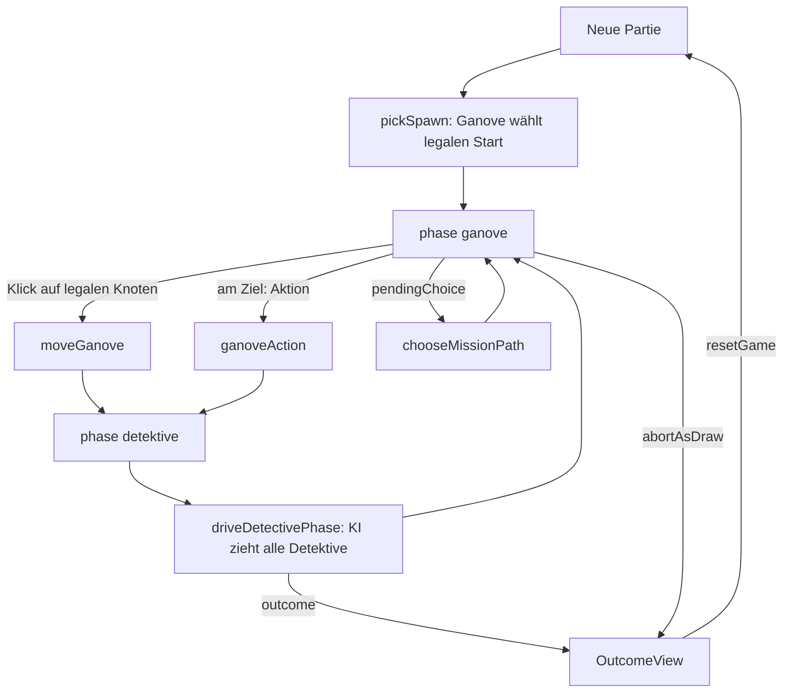

← [Zurück zur Übersicht](index.md)

# Spieloberfläche — Technischer Ablauf

## Übersicht

`GanoveScreen` orchestriert drei Ansichten (idle → pickSpawn → playing
→ outcome) über dem `useGameStore`-Zustand; `MapGraph` rendert die
Karte als SVG; `detectiveDriver` treibt die KI-Detektivphase
store-gebunden und deterministisch.

## Ablauf

### 1. Setup

`beginSetup` lädt die Karte via `loadMap(mapId)` (Default `muenster`,
überschreibbar per `?map=`), ermittelt den Seed (`?seed=`, sonst
`Date.now()`-basiert) und platziert die Detektive per
`pickDetectiveSpawns(map, createRng(seed), suggested)`. Der lokale
`setup`-State schaltet die Spawn-Wahl-Ansicht frei.

### 2. Ganove-Startwahl

`ganoveSpawnChoices(map, detectivePositions)` liefert die legalen
Kandidaten; nur diese sind interaktiv. Die Auswahl ruft
`startGame(map, seed, { detectivePositions, ganovePosition, mission })`
(`?mission=` erlaubt `auto`/`random`/`none`/`case:<id>`; Default
`random` mit `auto`-Fallback bei `MissionGenerationError`).

### 3. Ganove-Zug und KI-Detektivphase

1. `MapGraph` erhält `legalTargets = getLegalGanoveMoves()` — nur
   diese Knoten sind klick-/tastaturbedienbar (`role="button"`).
2. `onNodeSelect` → `moveGanove(nodeId)`; der Store validiert und setzt
   `phase: "detektive"` (oder `outcome` bei Flucht/Fang-Bedingungen).
3. `installDetectiveDriver` (Store-Subscription, installiert per
   `useEffect` in `GanoveScreen`) sieht die Transition und ruft
   `driveDetectivePhase()`: Schleife über `activeDetectiveIndex` mit
   `chooseDetectiveMove(buildDetectiveView(state,
   detectiveStartsFromLog(log)), index, getLegalDetectiveMoves(),
   aiRng(seed, round, index + 1))` + `moveDetective` bis die Phase an
   die Ganove-Phase zurückfällt oder `outcome` gesetzt ist —
   identische RNG-Konvention wie `AiSimulation`, Reentrancy-geschützt.

### 4. Missionsaktionen und Binärwahl

- `getMissionAction()` ≠ `null` → „Aktion ausführen" ruft
  `ganoveAction()` (Aktionsrunde, Zugzwang-Exception).
- `mission.pendingChoice` ≠ `null` → `MissionPanel` zeigt die zwei
  Optionen; `chooseMissionPath("sabotage"|"flucht")` ist final; in
  dieser Phase werden keine legalen Ziele angeboten.
- `getHeatLevel()` versorgt `HeatBadge`; `useRadio()` erzeugt das
  einmalige `polizeifunk`-Event, dessen `details.hints` im Intel-Feed
  gerendert werden.
- Der Intel-Feed rendert ausschließlich `visibleEvents(events,
  "ganove")` (`umwelt`, `polizeifunk`); Kameras und Detektiv-Hinweise
  existieren auf der Sicht nicht (strukturell, nicht gefiltert).

### 5. Ende

`abortAsDraw()` (mit Inline-Bestätigung) bzw. die Engine-Endbedingungen
setzen `outcome`; `OutcomeView` zeigt den lokalisierten Endtext und
`resetGame()` startet neu.

## Diagramm

## Fehlerbehandlung

- Regelverletzungen (`MoveError`, `SpawnError`, `GameConfigError`,
  `MissionGenerationError`) werden über `runGuarded` als
  `notice`-Statuszeile angezeigt statt die Oberfläche zu brechen.
- `MissionGenerationError` bei `mission: "random"` fällt automatisch
  auf `"auto"` zurück.
