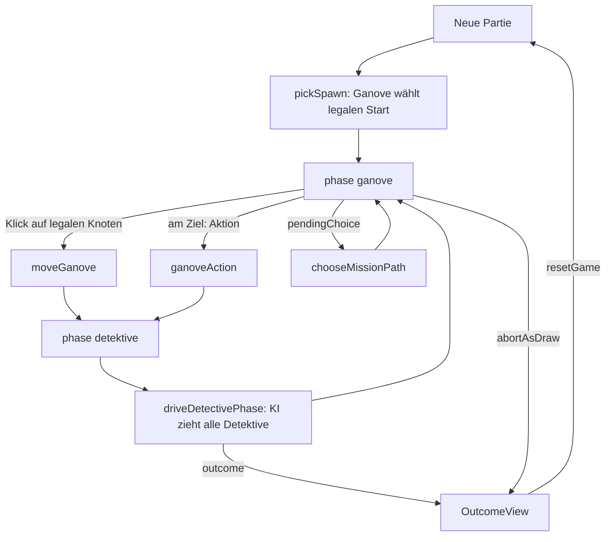
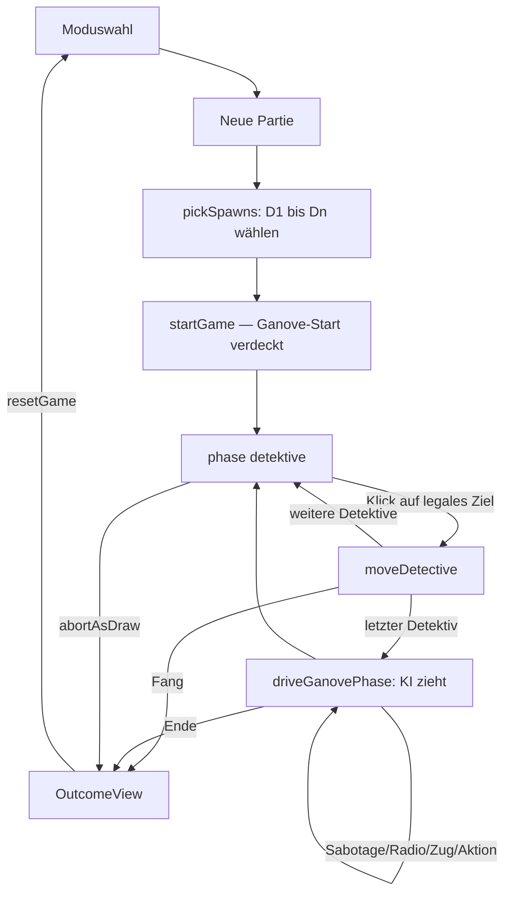

← [Zurück zur Übersicht](index.md)

# Spieloberfläche — Technischer Ablauf

Diese Seite dokumentiert den Anwendungsrahmen und beide Spielmodi.
`App.tsx` führt einen reinen Zustandsfluss (`MenuScreen`-Union aus
`src/components/menuFlow.ts` — kein Router-Paket):
`menu → map → mode → settings → mission → game` sowie die Seitenzweige
`dev`, `stats`, `resume` und `replay`. `?mode=ganove|detektiv` bleibt
als Deep-Link-Einstieg direkt in die Bildschirme erhalten.

## Menüfluss (Komponenten)

| Ansicht | Komponente | Aufgabe |
|---|---|---|
| `menu` | `MainMenu` | Neue Partie, Fortsetzen (aktiv sobald `listResumeEntries()` nicht leer), Statistiken |
| `map` | `MapSelect` | `MENU_MAP_IDS` aktiv laden, `FORTHCOMING_MAP_IDS` disabled |
| `mode` | `ModeSelect` | `ganove`/`detektiv` → `settings`, `dev` → `dev` |
| `settings` | `SettingsScreen` | korridorgebundene `StartGameOptions` (inkl. `roundLimit: null` nur bei `unlimited`, `eventMode` + vereinheitlichte Kadenz via `cadenceToEventDefaults`) |
| `mission` | `MissionSelect` | `case`/`random`/`custom`/`none`; `CustomMissionPicker` mit Kategorie-Picks + `validateCustomTargets` |
| `dev` | `DevModeScreen` | `runAiBatch` + `summarizeBatch` (aufgezeichnet via `Recorder`) |
| `stats` | `StatsScreen` | `aggregateStatistics(listGameLogs())` (Gesamt + je `playerMode`-Gruppe) plus Log-Verwaltung: `onReplay` → `replay`, `exportGameLog`, `deleteGameLog(index)`, `clearGameLogs` mit Rückfrage |
| `resume` | `ResumeScreen` | `listResumeEntries` mit Klartext (Karte, Seite, Runde, Zeitpunkt); `onResume(entry)`, `deleteResumeEntry` |
| `replay` | `ReplayScreen` | `openReplay` + `replayTo` über `useGameStore`; Timeline (vor/zurück/Abspielen), `visibleTo`-Perspektiven, Deduktions-Overlay; Unmount/`onBack` → `resetGame` |
| `game` | `GanoveScreen`/`DetektivScreen` | mit `options` + `startImmediately` + `onExit`; beide bieten „Partie speichern" (`buildResumeEntry` → `saveResumeEntry`) und schreiben `playerMode` in den Log-Header |

### Fortsetzen-Pfad

`onResume` (in `App.tsx`) lädt `loadMap(entry.mapId)`, ruft
`useGameStore.resumeGame(map, entry.snapshot, resumeLogEntries(entry))`
und öffnet den `game`-Screen mit `mode = entry.mode`. `startImmediately`
wird nur gesetzt, wenn der Store keine laufende Map enthält — der
fortgesetzte Snapshot springt dadurch direkt in die „playing"-Ansicht;
die KI-Treiber installieren sich wie immer per `useEffect`. Schlägt
`loadMap`/das Parsen fehl, wird der Eintrag gelöscht und die Liste neu
gerendert (`resumeRefresh`-Key).

### Replay-Pfad

Der Replay benutzt bewusst denselben Singleton-Store: `replayTo`
fährt `resetGame` + `startGame` (Header-Rekonstruktion) + die ersten
`n` Aktoreinträge. Der Screen ist exklusiv erreichbar (nur aus
`stats`), installiert **keine** KI-Treiber und setzt den Store beim
Verlassen per Cleanup/`resetGame` zurück — ein Live-Spiel kann nicht
unbemerkt überschrieben bleiben.

Die ausgewählte `MissionOption` plus Einstellungen wandern als
`PendingGameConfig` in `startGame`; feste Ziele (`case`/`custom`/
`resolvedMission`) engen über `ganoveSpawnChoicesForMission` die
legale Ganove-Startmenge ein — die Distanzregel bleibt unverändert
zuerst angewendet.

# Ganove-Modus

## Übersicht

`GanoveScreen` orchestriert drei Ansichten (idle → pickSpawn → playing
→ outcome) über dem `useGameStore`-Zustand; `MapGraph` rendert die
Karte als SVG; `detectiveDriver` treibt die KI-Detektivphase
store-gebunden und deterministisch.

## Ablauf

### 1. Setup

`beginSetup` lädt die Karte via `loadMap(mapId)` (Default `muenster`,
überschreibbar per `?map=`), ermittelt den Seed (`?seed=`, sonst
`Date.now()`-basiert) und platziert die Detektive per
`pickDetectiveSpawns(map, createRng(seed), suggested)`. Der lokale
`setup`-State schaltet die Spawn-Wahl-Ansicht frei.

### 2. Ganove-Startwahl

`ganoveSpawnChoices(map, detectivePositions)` liefert die legalen
Kandidaten; nur diese sind interaktiv. Die Auswahl ruft
`startGame(map, seed, { detectivePositions, ganovePosition, mission })`
(`?mission=` erlaubt `auto`/`random`/`none`/`case:<id>`; Default
`random` mit `auto`-Fallback bei `MissionGenerationError`).

### 3. Ganove-Zug und KI-Detektivphase

1. `MapGraph` erhält `legalTargets = getLegalGanoveMoves()` — nur
   diese Knoten sind klick-/tastaturbedienbar (`role="button"`).
2. `onNodeSelect` → `moveGanove(nodeId)`; der Store validiert und setzt
   `phase: "detektive"` (oder `outcome` bei Flucht/Fang-Bedingungen).
3. `installDetectiveDriver` (Store-Subscription, installiert per
   `useEffect` in `GanoveScreen`) sieht die Transition und ruft
   `driveDetectivePhase()`: Schleife über `activeDetectiveIndex` mit
   `chooseDetectiveMove(buildDetectiveView(state,
   detectiveStartsFromLog(log)), index, getLegalDetectiveMoves(),
   aiRng(seed, round, index + 1))` + `moveDetective` bis die Phase an
   die Ganove-Phase zurückfällt oder `outcome` gesetzt ist —
   identische RNG-Konvention wie `AiSimulation`, Reentrancy-geschützt.

### 4. Missionsaktionen und Binärwahl

- `getMissionAction()` ≠ `null` → „Aktion ausführen" ruft
  `ganoveAction()` (Aktionsrunde, Zugzwang-Exception).
- `mission.pendingChoice` ≠ `null` → `MissionPanel` zeigt die zwei
  Optionen; `chooseMissionPath("sabotage"|"flucht")` ist final; in
  dieser Phase werden keine legalen Ziele angeboten.
- `getHeatLevel()` versorgt `HeatBadge`; `useRadio()` erzeugt das
  einmalige `polizeifunk`-Event, dessen `details.hints` im Intel-Feed
  gerendert werden.
- Der Intel-Feed rendert ausschließlich `visibleEvents(events,
  "ganove")` (`umwelt`, `polizeifunk`); Kameras und Detektiv-Hinweise
  existieren auf der Sicht nicht (strukturell, nicht gefiltert).

### 5. Ende

`abortAsDraw()` (mit Inline-Bestätigung) bzw. die Engine-Endbedingungen
setzen `outcome`; `OutcomeView` zeigt den lokalisierten Endtext und
`resetGame()` startet neu.

## Diagramm

## Fehlerbehandlung

- Regelverletzungen (`MoveError`, `SpawnError`, `GameConfigError`,
  `MissionGenerationError`) werden über `runGuarded` als
  `notice`-Statuszeile angezeigt statt die Oberfläche zu brechen.
- `MissionGenerationError` bei `mission: "random"` fällt automatisch
  auf `"auto"` zurück.

---

# Detektiv-Modus

## Übersicht

`DetektivScreen` orchestriert drei Ansichten (idle → pickSpawns →
playing/outcome). `MapGraph` rendert dieselbe SVG-Karte wie im
Ganove-Modus, aber mit den detektivseitigen Erweiterungen. Der
store-gebundene `ganoveDriver` (`src/state/ganoveDriver.ts`) spielt
die komplette KI-Ganove-Phase synchron und deterministisch —
spiegelbildlich zum `detectiveDriver`.

## Ablauf

### 1. Einstieg

`App.tsx` liest `?mode=` einmalig beim Mount: `ganove` →
`GanoveScreen`, `detektiv` → `DetektivScreen` (Deep-Link ohne Menü);
ohne Parameter startet der Menüfluss des Anwendungsrahmens, der die
Komponente mit `options`, `startImmediately` und `onExit` versorgt.

### 2. Setup (Detektiv-Aufstellung)

`beginSetup` lädt Karte/Seed/Mission wie im Ganove-Modus
(`?map=`/`?seed=`/`?mission=`, geteilte Helfer in
`src/components/gameSetup.ts`). Bei `random`-Spawnregeln zieht
`pickDetectiveSpawns` die Posten sofort; bei `choice`/`free` öffnet
sich die `pickSpawns`-Ansicht: `detectiveSpawnChoices(map)` liefert
die interaktiven Kandidaten, jeder Klick legt den nächsten Posten
(D1 → Dn). Mit dem letzten Pick ruft `startGame` den Store —
`ganovePosition` wird intern gezogen, **nie** an die Komponente
gereicht.

### 3. Detektivzüge und KI-Ganove

1. `getLegalDetectiveMoves()` liefert die legalen Ziele des aktiven
   Detektivs (`activeDetectiveIndex`, fester Reihenfolge D1 → Dn) —
   nur diese sind interaktiv.
2. `onNodeSelect` → `moveDetective(nodeId)`; der Store prüft sofort
   den Fang und setzt nach dem letzten Detektiv `phase: "ganove"`.
3. `installGanoveDriver` (Subscription, `useEffect`) sieht die
   Transition und ruft `driveGanovePhase()`:
   `chooseSabotagePath` für `pendingChoice`, `shouldUseRadio` +
   `useRadio`, `chooseGanoveTurn` (mit `ganoveAction` am Missionsziel)
   bzw. `moveGanove` — jeweils mit `aiRng(seed, round, 0)` wie
   `AiSimulation`. Ende bei `phase: "detektive"` oder `outcome`.

### 4. Detektiv-Werkzeuge

- **Chronik:** `visibleEvents(events, "detectives")` — ein Datenfilter
  auf Store-Ebene; `polizeifunk`-Einträge erreichen die Ansicht
  strukturell nicht. Jeder Eintrag zeigt Runde, Art und Ort/Zone.
- **Marker:** `useState<Record<nodeId, comment>>`; Marker-Modus macht
  alle Knoten `markable`, ein Klick toggelt den Pin, Kommentare
  editiert die Markerliste. Reine UI-Daten — kein Eventlog-Eintrag.
- **Overlay:** `deducePossiblePositions({ map, detectiveStarts:
  detectiveStartsFromLog(log), events: intel, cameras, round,
  detectivePositions })` — wortgleich zur KI-Nutzung; die gerenderte
  Menge ist exakt die Engine-Menge.
- **Missionsstruktur:** `missionStructure(mission)` liefert Schritte +
  Status ohne Ziel-IDs; die Poolgrößen kommen aus
  `nodesByCategory(map, kind)`.
- **Kameras:** `visibleCameras(cameras, "detectives")` — inklusive
  `active`-Status für die Sabotage-Streichung.

## Diagramm

## Fehlerbehandlung

Wie im Ganove-Modus: `runGuarded` fängt `MoveError`/`SpawnError`/
`MissionGenerationError` als Statuszeile; `mission: "random"` fällt
bei GenerationError auf `"auto"` zurück.
